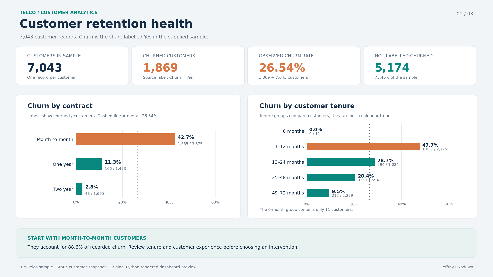
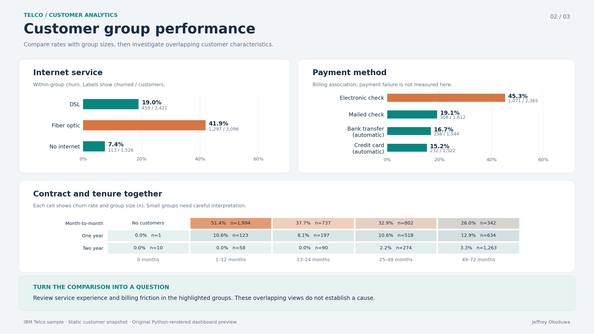
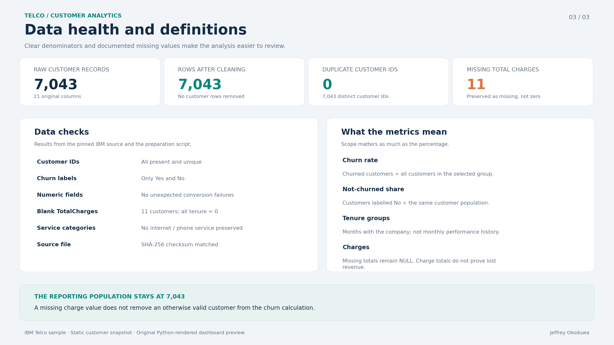

# Customer Churn & Retention Analytics

A retention manager needs to understand how many customers left, which groups account for those departures, and what deserves a closer investigation. This project explores **7,043 customer records** from IBM's Telco sample, comparing recorded churn across contracts, tenure, services and payment methods.

The work connects a business question to a clear measure: count the customers in a group, count those marked as churned, and compare the resulting share with other groups. Supporting counts and data checks make the findings easier to challenge and reproduce.

> **User story:** As a retention manager, I want to compare churn across customer groups while seeing the size of each group, so I can choose where to investigate and design a focused retention experiment.

## What is included

This repository is a refreshed, reproducible implementation of the customer churn project on my résumé. It includes data preparation, descriptive analysis, original dashboard figures, SQL Server scripts and Power BI build materials.

| Component | Implementation and scope |
| --- | --- |
| Python reference workflow | Downloads the pinned source, validates and prepares the records, calculates summaries, and renders three dashboard figures. |
| SQL Server workflow | Supplied scripts for preparing and analyzing the same data. Native SQL Server execution has not been completed for this release. |
| Power BI materials | Power Query, DAX measures, a theme and build instructions. The original `.pbix` file is unavailable and is not included; native Power BI execution is still to be checked. |

**The images below are original figures rendered with Python.** They are static previews of the analysis, not exports from an existing Power BI report. Their calculations can be reproduced with the build command below.

## Dashboard walkthrough

### 1. Customer health



Start with the denominator: **1,869 of 7,043 customers are marked as churned, or 26.54%**. The contract and tenure comparisons help locate the concentration. Month-to-month customers account for 1,655 of the recorded departures, with a within-group churn share of 42.71%. That gives a manager a specific group to investigate; it does not establish that the contract caused the departure.

### 2. Segment performance



Look at the rate alongside the number of customers. Fibre-optic customers have a recorded churn share of 41.89%, and electronic-check customers have a share of 45.29%. These views overlap: the same person can appear in both groups. The contract-by-tenure comparison helps examine customer mix before recommending an intervention.

### 3. Data quality



All **7,043 customer rows are retained**. The source contains **11 blank `TotalCharges` values**, all on records with zero tenure and `Churn=No`. Those values remain missing after preparation. Removing the records would change the churn denominator; replacing unknown charges with zero would introduce an assumption. The page shows the checks behind these decisions.

Read the [dashboard guide](docs/DASHBOARD_GUIDE.md) for definitions, a suggested demonstration and explanations of each page.

## Key results

These figures describe the pinned sample. Each segment rate uses the customer count within that segment as its denominator.

| Measure | Customers | Churned | Observed churn share |
| --- | ---: | ---: | ---: |
| Entire sample | 7,043 | 1,869 | 26.54% |
| Month-to-month contract | 3,875 | 1,655 | 42.71% |
| One-year contract | 1,473 | 166 | 11.27% |
| Two-year contract | 1,695 | 48 | 2.83% |
| Tenure of 1–12 months | 2,175 | 1,037 | 47.68% |
| Fibre-optic internet | 3,096 | 1,297 | 41.89% |
| Electronic-check payment | 2,365 | 1,071 | 45.29% |

The remaining **5,174 customers have `Churn=No`** in this snapshot. That label does not confirm that they are active customers today.

The initial business recommendation is a focused review of early customer experience and the large month-to-month group. Useful follow-up evidence would include onboarding issues, service incidents, billing complaints and cancellation reasons. Those records are outside this dataset. The [business case](docs/BUSINESS_CASE.md) explains how to move from the findings to a testable retention proposal.

## Data and metric decisions

The source is the **classic 21-column IBM Telco Customer Churn sample**, pinned to commit [`d5371f5d83a446ad5673cbcca3b814b926491f8a`](https://github.com/IBM/telco-customer-churn-on-icp4d/blob/d5371f5d83a446ad5673cbcca3b814b926491f8a/data/Telco-Customer-Churn.csv). Its download location and SHA-256 checksum are recorded in [data/source.json](data/source.json).

Preparation trims whitespace, validates the expected schema and categories, checks customer-ID uniqueness, and converts numeric fields. It preserves meaningful labels such as `No internet service` and adds a churn flag, ordered tenure bands and a missing-charge indicator. Zero-tenure customers have their own band; they are not silently grouped with customers who have completed a month.

The core measure is:

```text
Observed churn share = customers marked Churn=Yes / customers in scope
```

There are no event dates in this CSV. Tenure bands compare different customers; they are not calendar trends or retention curves. The file also lacks cancellation reasons, satisfaction scores, geography and individual churn probabilities. Associations can suggest an investigation, but they cannot establish a cause or a measured retention improvement. Summed monthly charges would describe recorded charge amounts, not audited lost revenue or recoverable savings; no such financial outcome is claimed here.

The raw customer CSV is downloaded from IBM rather than bundled. The cleaned customer CSV is generated locally. Source provenance and licensing scope are documented in [Data Source](docs/DATA_SOURCE.md).

## Repository map

| Location | Responsibility |
| --- | --- |
| `scripts/` | Source verification, preparation, summary calculations and figure rendering. |
| `sql/` | SQL Server preparation and analytical queries. |
| `powerbi/` | Power Query, DAX, theme and report-building instructions. |
| `data/source.json` | Pinned source metadata and expected checksum. |
| `data/raw/` | Downloaded source CSV after the first build. |
| `data/processed/` | Generated customer-level CSV for further analysis. |
| `reports/` | Computed metrics and segment summary CSVs. |
| `images/` | The three original dashboard figures shown above. |
| `tests/` | Checks for the data preparation and reference calculations. |
| `docs/` | Business case, dashboard explanation and source information. |

## Run the reference workflow

Use **Python 3.9 or later**; the repository's CI configuration uses Python 3.11. Open Terminal in the project folder on macOS or Linux, then run:

```bash
python3 -m venv .venv
source .venv/bin/activate
python -m pip install -r requirements.txt
python scripts/build_project.py
python -m unittest discover -s tests -v
```

On Windows, activate the environment with `.venv\Scripts\Activate.ps1` in PowerShell. The installation, build and test commands assume you are in the folder containing this README.

The first build needs internet access to download the pinned CSV. Every build verifies its checksum, including when the file already exists. It writes `data/processed/telco_customers.csv`, `reports/metrics.json`, segment summary CSVs and the three images. These outputs are regenerated when you rerun the build.

For a quick reconciliation, confirm that `1,869 + 5,174 = 7,043`, the overall churn share rounds to `26.54%`, and the missing `TotalCharges` count remains `11`. The tests check important reference and preparation behavior. They do not substitute for executing the supplied SQL Server scripts or validating the DAX measures inside Power BI.

## What this project demonstrates

The project demonstrates data preparation, metric design, segment analysis, reproducibility and communication. It gives a reviewer a way to follow a headline back to customer counts and the rules that produced it. A next iteration could add operational records and evaluate a retention pilot; no campaign, predictive model or measured commercial impact is presented as completed work.
